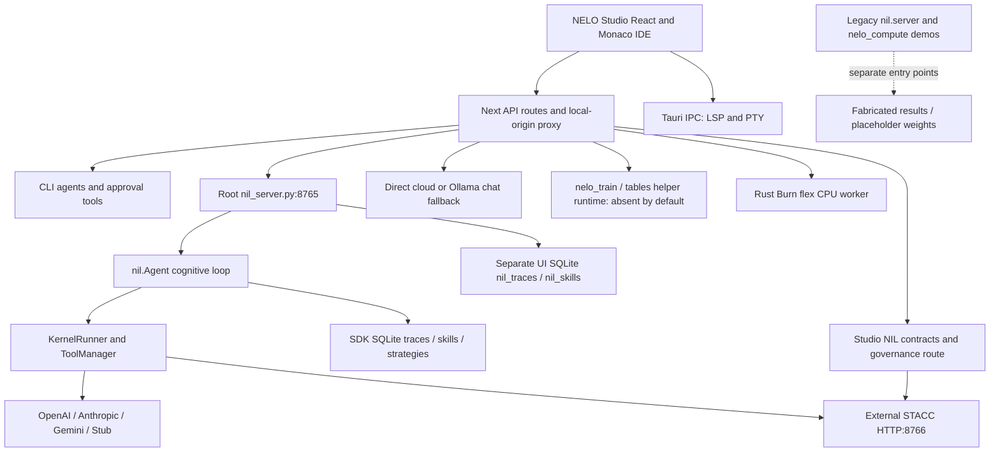
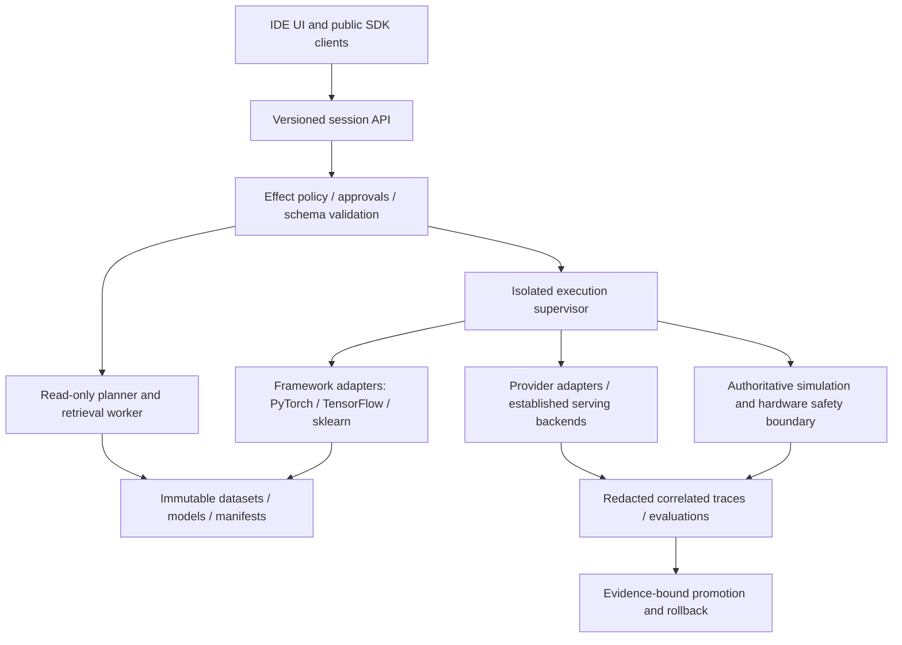

# AI Architecture Review

Audit date: 2026-11-14. Scope: NIL at `ed7f987ced82bbb59c8373c1d9bd3d9dd7cd8563` and adjacent NELO Studio IDE at `e517c6e02cd1e8bf59fccaa8c947143cae67537c`. Reports reside in NIL because that is the writable workspace. NELO Studio **is the IDE**; NIL is an agent SDK/backend, not the complete IDE. Existing audit documents were not treated as test evidence. No existing source code was modified.

Evidence is local source inspection and explicitly listed safe probes. No external API requests, dependency downloads, model downloads, cloud jobs, deployments or hardware access were performed. Optional installed runtimes and release bundles may differ from these checkouts; their functionality is not assumed.

## Current module boundaries

The governance route and root-daemon tool route are distinct paths to STACC. A gate in one path does not cover the other. The IDE first tries the agent daemon, then falls back to direct provider chat with different context/capabilities. This is genuine integration code, but not one coherent runtime contract.

## Public SDK API and dependencies

NIL exports Agent, Domain, tool, memory and robotics from one eager __init__. Importing the basic SDK therefore requires NumPy despite absent core dependency metadata. Agent construction has import-time memory creation and shared default objects. Domain tools are expected to be Tool objects, while the embodied domain supplies functions. Provider abstraction is duck-typed chat dictionaries with three concrete adapters and a stub, rather than a public Protocol with capability/error/streaming contracts. Unknown provider names fall through to StubProvider, which can invoke the first tool. A missing credential should fail closed in production execution.

Consolidate the two same-name/version pyprojects. Define core, providers, robotics, training and dev extras; lock tested environments and support Python/OS combinations explicitly. A fresh wheel import and a public API smoke should be release gates. requirements.txt packages do not establish TensorFlow, PyTorch or scikit-learn integration. Do not redesign general training engines; wrap established frameworks.

## Runtime and process isolation

Studio separates native IPC, Node API, Rust/C++ workers and Python daemons. Training supports direct process, Docker and torchrun launch paths, and session agents have Linux rlimit/environment policies. NIL tools, providers, cognition and memory share one Python process; tools have host-process permissions. Threaded graph execution is concurrency, not a sandbox. Hard cancellation/resource limits are not guaranteed by config fields. Root HTTPServer serializes requests. Process-global temporary provider environment and shared memory/client caches obstruct safe multitenancy or future threading.

Use a supervisor with per-session immutable configuration, explicit cancellation/deadlines, bounded queues, process ownership tokens and health restart policy. Separate read-only planning from effectful execution. Keep subprocess environments minimal and ensure secrets never enter general traces. Linux prlimit behavior is not equivalent to Windows/macOS isolation.

## GPU and performance

The visual network worker explicitly reports flex CPU; graphics rendering and Rerun do not prove CUDA inference. Training container GPU flags and ONNX provider enumeration exist. Python runtime/wheels, drivers and target device compatibility determine actual acceleration; none was tested. No operative pruning, calibration quantization or dynamic server batching pipeline was found. Ollama catalog quantization strings are model metadata, not a quantizer implementation.

## Data and model artifacts

SQLite stores agent traces, skills and strategy versions; UI storage separately stores nil_traces/nil_skills. Project JSON/JSONL represents runs, dataset hashes, approvals, policy versions and serving processes. Dataset lineage depends on run.dataset events. Artifact tests describe copied/hashed files and directories, but their nelo_train implementation is absent. Dataset versions do not retain bytes. Legacy compute model registry writes text headers and marks models installed/running without a loaded backend. Model weight provenance, signed promotions and complete training lineage are not unified.

Use immutable content-addressed artifacts with framework, schema, source revision, dataset hash, base-model hash and environment metadata. Derive UI state from one canonical store, with migrations/retention and crash-safe writes. Integrate MLflow registry and DVC or equivalent rather than inventing incompatible formats.

## Plugins and extensibility

Studio has manifest validation, enabled states and MCP tool transport; known capability is currently agent.tools. This is useful custom extensibility, not evidence of arbitrary VS Code extension compatibility. Cognitive plugins implement phase hooks; their execution shares kernel trust. Permissions listed in a manifest require process/transport enforcement. Specify a versioned tool/effect API and test a minimal external plugin, crash recovery and denied filesystem/network access.

## Security boundaries

The primary Next API proxy and root daemon check loopback host/browser origin; root daemon binds 127.0.0.1. This protects against some browser-origin and DNS-rebinding attacks, not other local processes. Studio has AES-256-GCM secret storage and approval/audit helpers. Root daemon caches raw API keys in cache-key tuples and uses temporary global env overrides. Legacy server binds all interfaces with wildcard CORS. Context and retrieved content can influence in-process tools without one shared capability policy. Lexical startsWith path checks in serving/media/tool paths merit realpath/symlink tests; this is a suspected boundary weakness, not a reproduced exploit. Audit JSONL is mutable and same-user-readable; no tamper-proof security log established.

## Robotics IDE integration

NIL root tools issue HTTP status, joint command, IK and gain requests to STACC. Studio separately maps typed actions to /v1/runtime/* and applies governance. The standalone STACC bridge uses a developer-specific /home/lucy path and returns zero poses on failure. Sensorium is an in-memory buffer; object detection in the manipulation domain reads an existing world dictionary. The gatekeeper lacks collision/torque checks; a safety objective string does not supply them. The current evidence supports a robotics simulation integration design with partial implementations, not safe physical autonomy.

## Cross-platform compatibility

Tauri configuration and Linux/macOS/Windows packaging scripts indicate intended support. No desktop release was built or exercised. Hardcoded POSIX developer paths, process groups/signals, Linux quotas, external Python executables and model/GPU wheel availability require OS-specific validation. Pin platform-runtime manifests and maintain a functional matrix for terminal, LSP, debugger, training, serving and robotics.

## Recommended target architecture

This is a recommendation, not an existing API. Keep IDE state/presentation, orchestration policy, framework computation and physical control distinct, with explicit versioned contracts.

## Architecture evidence

- `../NELO-Studio/package.json:1`
- `../NELO-Studio/apps/desktop-tauri/src-tauri/tauri.conf.json:1`
- `../NELO-Studio/lib/training/runs.ts:230`
- `../NELO-Studio/lib/notebook/kernels.ts:41`
- `../NELO-Studio/lib/plugins/registry.ts:21`
- `../NELO-Studio/lib/domain/nil/bridge.ts:90`
- `../NELO-Studio/lib/domain/nil/governance.ts:96`
- `../NELO-Studio/proxy.ts:1`
- `../NELO-Studio/lib/secretStore.ts:1`
- `nil-sdk/nil/agent.py:35`
- `nil-sdk/nil/kernel/runner.py:60`
- `nil-sdk/nil/kernel/graph/scheduler.py:1`
- `nil-sdk/nil/memory/store.py:1`
- `nil_server.py:161`
- `../NELO-Studio/crates/nelo-ml-worker/src/main.rs:35`
